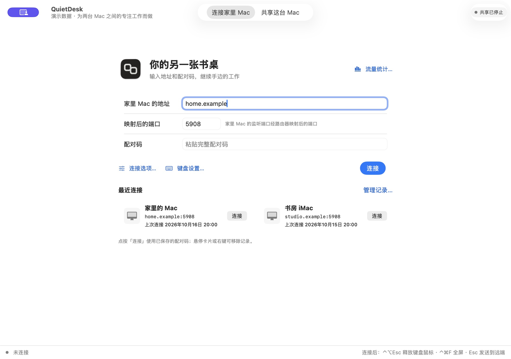
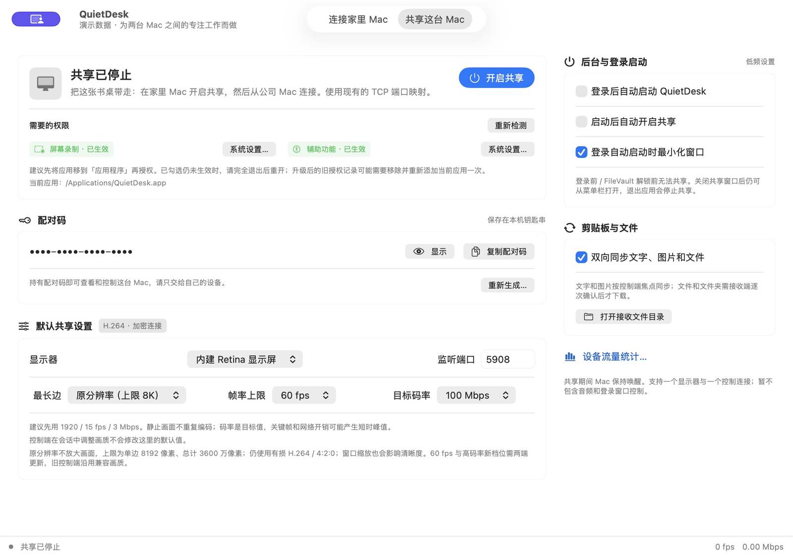
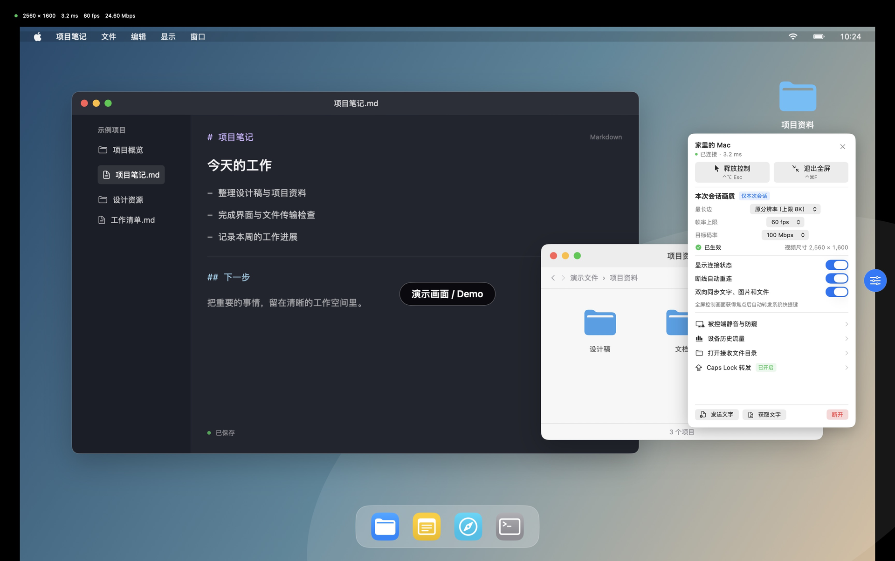
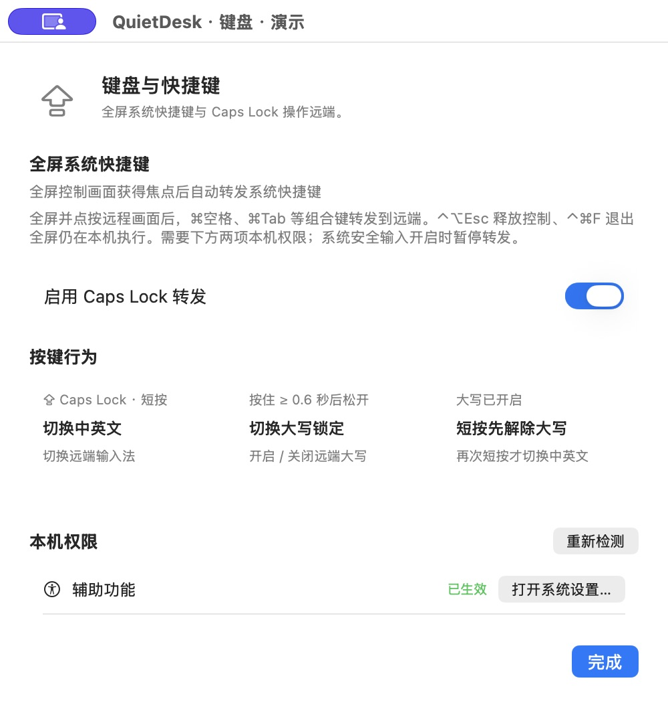
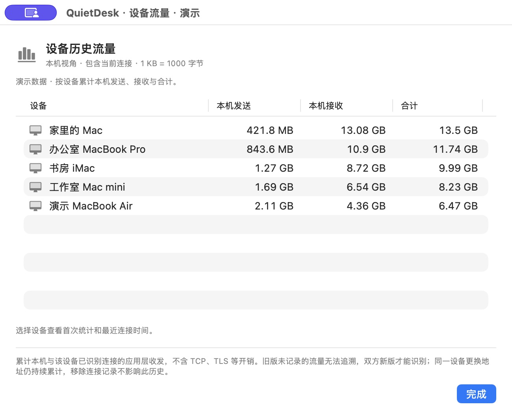
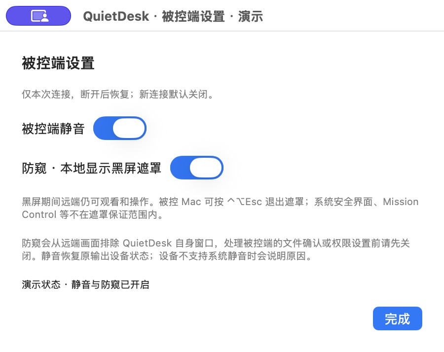

# QuietDesk

[简体中文](README.md) · **English**

A native macOS remote desktop app for your own Macs. Connect directly over a LAN or your own reachable network setup, without an account or relay service.

**macOS 14+ · Apple Silicon & Intel · MIT**

[Download releases](https://github.com/nXiaoK/QuietDesk/releases/latest) · [Build status](https://github.com/nXiaoK/QuietDesk/actions) · [User guide (Chinese)](docs/usage.md)

> Features and screenshots describe the current source; release binaries may differ. Screenshots use demo data. The app interface is currently Chinese.



## Features

| Feature | What it does |
| --- | --- |
| Remote control | Mouse, keyboard, drag, scroll, and floating fullscreen controls |
| Video transport | Updated peers prefer encrypted UDP, recover or fall back to TCP automatically, and keep input on a reliable channel |
| Immediate cursor | Updated peers separate the cursor from video to reduce duplicate pointers; optional system shape synchronization falls back to a generic arrow |
| Video settings | Manual choices cap automatic adaptation in the new media mode; up to 60 fps and a 100 Mbps target bitrate |
| Clipboard & files | Focus-aware text and image sync; confirmation before transferring files or folders |
| Keyboard & permissions | Fullscreen system shortcuts, Caps Lock input-source switching, and permission guidance with a draggable app icon |
| Connections & idle pause | Recent connections, automatic reconnect, and pause after 10 minutes without window input, resuming when you return to the window |
| Background sharing | Launch after login, share in the background, and recover from display changes |
| In-app updates | When a signed feed is configured: check, download and verify, then confirm installation and restart |
| Endpoint traffic | Persistent sent/received totals by hostname/IP and port |
| Session controls | Remote mute and a black-screen overlay on the host Mac, both off by default |

<details>
<summary>More feature screenshots</summary>

| Sharing & background settings | Fullscreen control |
| --- | --- |
|  |  |
| **Video & connection settings** | **File approval** |
|  |  |
| **Keyboard & shortcuts** | **Traffic history (earlier UI)** |
|  |  |
| **Mute & black-screen overlay** | **Idle pause** |
|  |  |
| **Permission guide** | |
|  | |

These are UI demonstrations, not evidence of real-device performance or permission tests.

</details>

## Quick start

1. Install QuietDesk on both Macs and move it to Applications.
2. **Host Mac:** choose **共享这台 Mac** (Share this Mac), grant Screen Recording and Accessibility, start sharing, and copy the pairing code.
3. **Controlling Mac:** enter the host address, port and pairing code. On a LAN, use its local IP and default port `5908`. For public port forwarding, map TCP and UDP on the same external port to the same listening port on the host. TCP remains available when UDP cannot be reached.
4. Click the remote desktop to control it. `⌃⌥Esc` releases input; `⌃⌘F` toggles fullscreen. System shortcut forwarding and Caps Lock features also need Accessibility and Input Monitoring on the controlling Mac.

Treat the pairing code as a remote-control credential and share it only through a trusted channel. [Permissions and troubleshooting (Chinese) →](docs/usage.md#permissions)

## Updating QuietDesk

The first version with the updater must still be installed manually from [Releases](https://github.com/nXiaoK/QuietDesk/releases/latest). The repository currently has an empty update public-key table, so update controls remain hidden until the maintainer configures a public key and publishes an enabled build.

Once enabled, QuietDesk asks whether to check automatically. If you agree, it checks at most once every 24 hours; it never downloads or installs automatically. You can also choose **检查更新…** (Check for Updates) in the app menu or menu bar. Downloads show actual progress, and installation requires another confirmation. Installation is blocked while this Mac is being remotely controlled; a manual-install option is available when automatic replacement cannot proceed. [Update guide (Chinese) →](docs/usage.md#应用内更新)

Release builds remain ad-hoc signed. **After every update, grant Screen Recording, Accessibility and Input Monitoring again on the local Mac.** Arrange updates when someone can operate the host Mac locally.

## Before you use it

- New features need support at both ends. One display and one controlling connection are supported at a time. Audio streaming, login-window control and FileVault unlock are not supported.
- Native resolution still uses lossy H.264, and frame rate depends on hardware and network conditions. The software black-screen overlay cannot guarantee coverage of system security screens. [Security and limitations (Chinese) →](docs/security.md)
- **画质与连接** shows the active transport and applied video settings. **仅使用 TCP（下次连接生效）** selects TCP for the next connection. The displayed RTT measures the control connection; FPS does not measure physical screen presentation. [UDP/TCP transport (Chinese) →](docs/udp-tcp-transport.md)
- Default builds are ad-hoc signed and not Apple-notarized. You may need to reopen the app after granting permissions. Every update requires granting permissions again; rely on the app’s actual permission checks.

## Documentation & development

[User guide (Chinese)](docs/usage.md) · [UDP/TCP transport (Chinese)](docs/udp-tcp-transport.md) · [Security (Chinese)](docs/security.md) · [Build & test (Chinese)](docs/development.md)

With Apple Command Line Tools, Swift 5.9+ and Python 3 installed, run from the repository:

```sh
./build-app.sh universal
```

Output: `dist/QuietDesk.app`. Licensed under [MIT](LICENSE).
