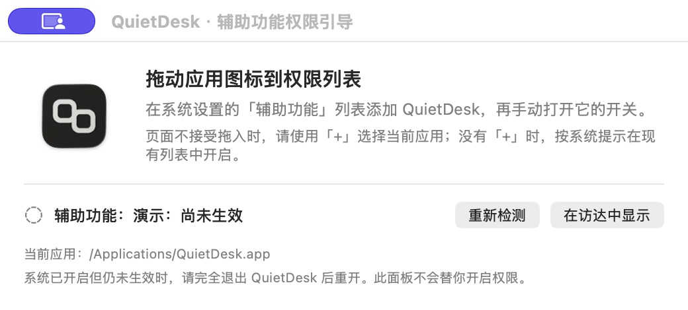
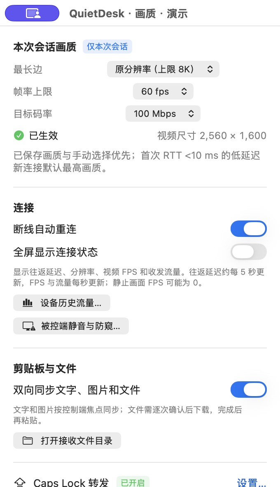
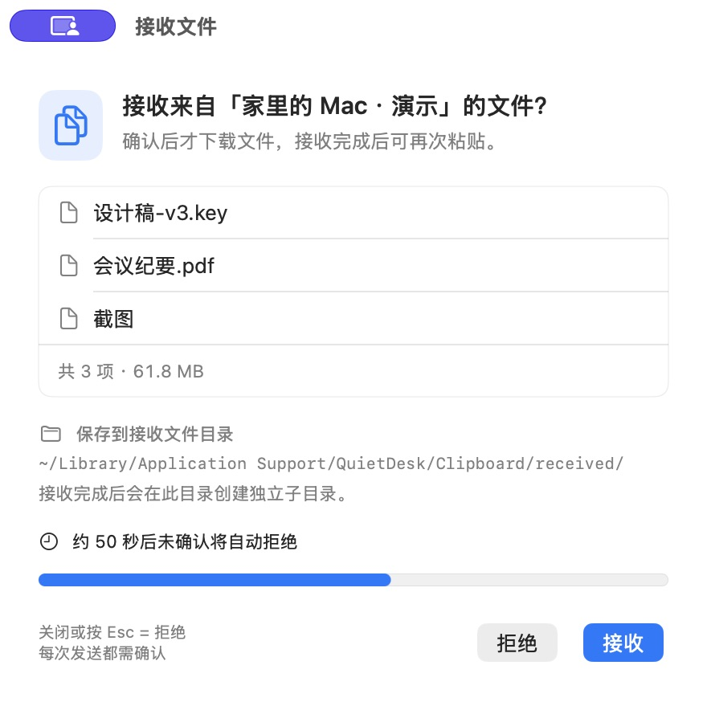
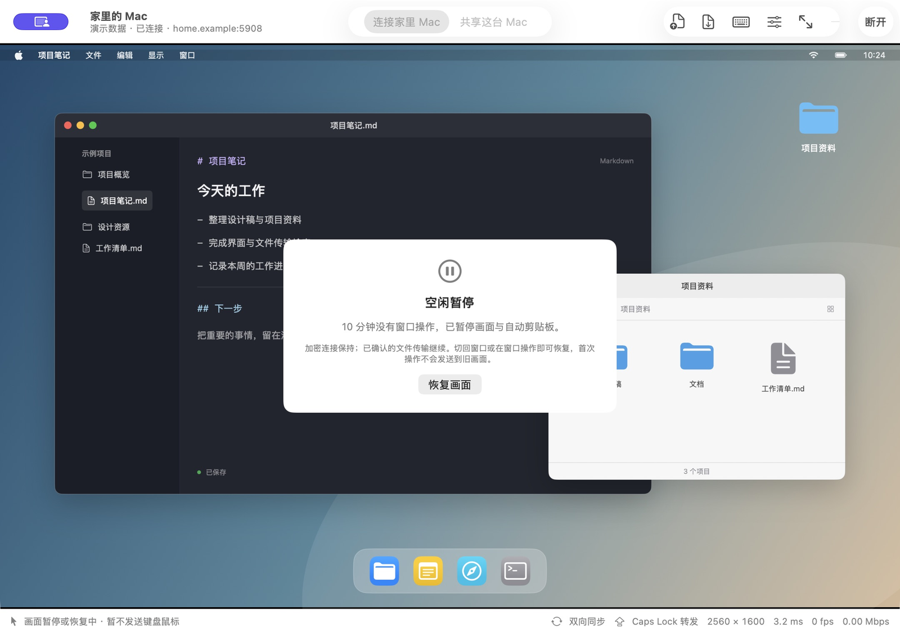

# 使用指南

[返回中文首页](../README.md) · [English README](../README.en.md) · [传输说明](udp-tcp-transport.md) · [安全说明](security.md)

本指南对应当前源码。建议两端都更新；旧版本只启用双方共同支持的功能。界面截图均为演示数据。

## 连接两台 Mac

1. 将应用放到两台 Mac 的“应用程序”文件夹，再打开。
2. 被控端选择“共享这台 Mac”，补录原配对码或明确生成新码，完成屏幕录制与辅助功能授权，选择显示器并开启共享。未授予辅助功能时只能观看。
3. 控制端选择“连接家里 Mac”，填写被控端地址、端口和完整配对码。地址不带 `http://`；IPv6 不加方括号，端口单独填写。
4. 局域网直接使用被控端内网地址，默认监听端口为 `5908`。跨网需要可达地址；使用路由器映射时，控制端填写外部端口。应用不会自动配置路由器。没有端口映射时可使用[自托管中继](relay.md)，中继下的视频可尝试打洞直连。
5. 点按远程画面开始控制。`⌃⌥Esc` 释放键盘鼠标，`⌃⌘F` 切换全屏，`⌃⌘S` 截取远端画面到剪贴板，普通 Escape 仍送到远端。

配对码等同于控制凭据，请仅通过可信渠道传递。它保存在本机私有文件 `~/Library/Application Support/QuietDesk/Credentials/pairing-codes.json`，由当前账户的文件权限保护，未单独加密；停止共享后重新生成会使旧码失效。

开启共享后仍可切到“连接家里 Mac”去控制另一台 Mac，无需先停止共享；两个角色同时在后台运行，但同一时间只有一个控制会话：这台 Mac 连接其他 Mac 期间（含自动重连等待），收到的控制连接会被拒绝，对方按自动重连稍后再试；这台 Mac 正被控制时不能外连，需等对方断开。外连会话进行中模式切换按钮锁定，断开后可切回；工具栏左侧的共享状态和菜单栏菜单会显示共享是否仍开启。中继设置由两个角色共用，修改前需同时停止共享并断开连接。

成功连接会保存地址与画质偏好，配对码独立存入上述本机文件。“管理记录…”可查看或移除记录，移除时仅删除本机文件中的对应配对码。自动重连可在“画质与连接”关闭；主动断开会取消后续重试。

在被控端“共享这台 Mac”顶部或菜单栏点按“断开控制端”，会立即结束当前控制会话，共享监听和中继登记保持开启，仍可手动重新连接。它会停止画面、键鼠、剪贴板和未完成的文件传输，沿用会话结束时恢复防窥、亮度、静音及“断开锁屏”的处理。两端均支持结束通知时，控制端显示“被控端已结束本次连接”，停止本次自动重连和线路回退，不改变已保存的自动重连偏好。旧版控制端、握手/画面准备阶段尚未完成协商，或结束通知未送达时，仍可能按网络断开自动重连；若需停止接受任何连接，请使用“停止共享”。

从钥匙串版升级时，旧钥匙串条目保留，但应用完全不再访问它们。主机在配对码区域手动补录旧码并保存，再开启共享；也可明确选择生成新码，此时需要更新控制端的配对码。控制端点按旧连接记录后若提示缺码，在上方输入原码再连接，成功后会保存在本机文件中，原连接记录与画质偏好继续沿用。未完成主机补录时，自动共享保持关闭状态，原来的自动启动偏好仍保留。

## 传输方式与公网端口

新版双方连接后，先建立配对认证的 TCP 控制连接，再优先尝试加密 UDP 视频。UDP 不可用或媒体恢复失败时，自动使用独立 TCP 视频连接；辅助连接也不可用时，使用控制连接中的媒体封装兜底。键盘、鼠标与会话控制始终使用可靠 TCP，文件与自动剪贴板数据优先使用独立 TCP 数据连接。旧版本继续使用原来的兼容协议。

默认监听同一个数字端口 `5908` 的 TCP、UDP。公网映射时，控制端填写外部端口 `Q`，路由器需同时配置 **TCP `Q` → 被控 Mac 的 `P`** 和 **UDP `Q` → 同一台 Mac 的 `P`**；`P` 是被控端实际监听端口。例如两条规则均为外部 `15908` → 内部 `5908`。TCP、UDP 使用不同外部数字端口时，当前界面无法分别填写。只开放 TCP 仍可连接，但不会使用 UDP 视频。

“画质与连接”显示“UDP 视频”“TCP 视频”或“TCP 兼容模式”。切换期间等待新关键帧解码、提交后才显示为新路径。“仅使用 TCP（下次连接生效）”用于选择下一次连接的传输方式，当前连接不会立即切换。

短时丢包会先尝试有限补传或新关键帧恢复；持续恶化可能先降低视频负载，再试用 TCP。回退后有冷却和恢复探测，静止画面、空闲暂停不会单凭没有新视频帧就判为故障。应用不提供公共中转或音频传输，也不为新传输申请额外系统权限；自托管中继下的视频打洞见[中继打洞](relay.md#中继打洞)。实现和验收边界见 [UDP/TCP 传输说明](udp-tcp-transport.md)。

## 鼠标双指针与即时光标

新版双方默认启用“本地即时光标”，从视频里去掉远端鼠标，由控制端立即显示指针，减少“一前一后、停止后重合”的双指针现象。普通窗口和全屏的“画质与连接”均可关闭。状态显示实际使用的模式；远端系统无法提供形状时显示“通用指针”，旧端仍使用视频光标。自定义、动画光标及自动隐藏行为可能无法完整还原，详见 [实现与验证边界](independent-cursor.md)。建议两台 Mac 同时更新后重新连接测试。

滚动按控制端的设备原样交给被控端：普通鼠标滚轮按“行”发送，被控端应用按自己的行高滚动，与在被控端本机用滚轮一致；触控板、妙控鼠标等精确滚动附带手势开始/结束和惯性阶段，被控端应用可以按手势处理。手指保持接触时，停顿不会自动结束手势；指针移出画面时控制端显式取消手势或结束惯性，断开、失去焦点或释放控制时清理未完成的阶段，并保留收尾时的修饰键。需两端都更新；任一端为旧版时仍按像素滚动。滚轮按行后，部分应用每格的滚动距离会与以前不同。

## 权限与授权排障

| 位置 | 权限 | 用途 |
| --- | --- | --- |
| 被控端 | 屏幕录制 | 共享桌面 |
| 被控端 | 辅助功能 | 接收键盘鼠标控制 |
| 控制端 | 辅助功能、输入监控 | Caps Lock 与全屏系统快捷键捕获 |

从应用进入权限设置时直接跳转到对应页面，不再主动弹出一层系统授权请求。尚未生效时，可把引导浮窗的应用图标拖入系统权限列表，再手动打开开关。页面不接受拖入时，使用“+”选择当前应用。应用不会替你授予权限。

检测到当前引导对应的权限实际生效后，浮窗会自动关闭；如果已经生效，则不再显示浮窗。检测沿用约每两秒的刷新及返回应用时的检查，系统勾选但进程尚未生效时仍保留引导。开启共享时缺少录屏权限会跳转设置并显示状态说明，不再叠加“知道了”弹窗。实际录屏运行中系统自身的提醒或重启要求仍由 macOS 控制。

系统已勾选、应用仍显示未生效时：先完全退出并重开；核对“当前应用”是否为安装位置的这一份。若升级导致旧授权失效，再移除旧条目、添加当前应用并重开。“重新检测”读取实际状态，开关启用不代表监听已经运行。

默认临时签名未经过 Apple 公证，每次更新后都需要在本机重新授予屏幕录制、辅助功能和输入监控权限。系统设置仍显示勾选也不代表当前进程已经生效，请沿用上述实际检测与重新授权步骤。自行构建使用稳定签名身份时，也不能保证所有 macOS 版本都会保留授权。

## 应用内更新

旧版 0.7.x 没有更新器，首次安装带更新器的版本仍需从 [GitHub Releases](https://github.com/nXiaoK/QuietDesk/releases/latest) 手动下载并替换。当前仓库的 `Resources/update-feed.json` 公钥表为空，因此应用隐藏更新入口，也不询问或访问更新源。只有维护者配置公钥并发布启用的构建后，以下功能才可用。

首次启动会询问“自动检查更新？”，只检查版本，不自动下载或安装。主窗口不可见、应用不在前台、正在控制、全屏、这台 Mac 正被远程控制或已有其他弹窗时，会推迟询问。选择保存后不再询问，可在菜单栏修改“自动检查更新”。未作选择前不做自动检查；手动检查不会替你作选择。同意后，启动约两分钟起可以自动检查，两次自动检查至少间隔 24 小时，跨重启保留。

随时可用应用菜单 QuietDesk →“检查更新…”或菜单栏同名入口手动检查。有新版本时，菜单栏显示“新版本 x.y.z 可用…”。正在控制、全屏或共享时，自动结果只更新菜单项；其他时候主窗口可显示可关闭的提示条。自动检查失败不会弹窗；手动检查会说明已是最新、暂无更新信息、网络失败、校验失败或需要更高 macOS 版本。

更新面板显示版本、日期、归档大小和纯文本说明，可选择“下载并安装”“稍后”或“跳过此版本”。跳过只影响这一个版本的自动提示，更高版本仍会提示，手动检查也会忽略跳过设置。下载显示真实接收字节；总长度未知时显示不确定进度，可以取消后重试。下载与校验完成后，还要点击“安装并重新启动”并确认；确认框默认选择“取消”。

**这台 Mac 正被远程控制时，可以下载，但不能安装。** 临时签名版本更新后需要本机重新授权，远程可能无法连回；请先停止共享，或安排能在本机操作时更新。其他活动连接或共享会在安装时停止，确认框会说明。重启后按原有“启动后共享”偏好尝试恢复共享，权限未生效时仍需完成现有授权引导。

应用位于 DMG 等只读卷、App Translocation 路径、当前账户无目录写权限，或替换被系统“App 管理”阻止时，改用“手动安装”前往 Release 页面。如新版应用已完成校验与暂存，可用“在 Finder 中显示”找到它再手动替换；不要尝试在远程无人值守时重新授权。应用不提权，也不代替你修改系统权限。更高系统版本要求、校验失败或发布信息暂不可用时，可稍后重试或按提示手动下载。

更新只替换整个应用包，保留连接记录、配对码和原有偏好。缓存及安装结果位于本机缓存目录的 `QuietDesk/Updates/` 下，与连接凭据分开；完成后的提示以实际安装结果为准。[更新安全与边界](security.md#应用内更新) · [维护者配置与检查](development.md#更新签名与发布)

## 画质、全屏与键盘

开启“全屏显示连接状态”后，状态默认在右下角竖排显示，每行一项：连接时长、视频线路、解码 FPS、收发流量、本次连接累计流量、往返延迟、UDP 丢包（达到 3% 时为红色）、分辨率；不再显示画质上限。线路名精简为 UDP、TCP、中继 UDP 或直连 UDP 等，使用 11 pt 紧凑字形和等宽数字，分辨率不留乘号两侧空格。累计流量以“累计”开头，是本次连接视频、控制、剪贴板与文件各通道收发的合计，按 1 KB = 1000 字节显示（KB、MB 保留一位小数，GB 起两位），只含应用层数据、不含 TCP/TLS 开销，约每秒更新；断线自动重连后与连接时长一起从零开始，按地址累计的历史总量见“设备历史流量”。状态为圆角黑色底框上的白字，文字不随画面明暗变色。可直接拖动状态浮层，避开远端菜单或正在查看的内容；拖动时会释放远程控制，点按画面可继续控制。普通窗口的“画质与连接”和全屏“控制与设置”中均可调节“背景透明度”（0%–100%，默认 60%，数值越大底框越透明，100% 时不显示底框）；它只改变底框，文字保持不透明。底框越透明，文字阴影越明显，但白色画面上仍会更难辨认。也可“恢复自动位置”回到右下角。位置与背景透明度保存在本机，退出全屏或重启后继续使用；切换屏幕或状态尺寸变化时，位置会限制在当前画面范围内。旧版横排状态保存的拖动位置不沿用，升级后从右下角开始；旧版“状态透明度”调的是文字，升级后不沿用，底框从默认 60% 开始。

画面停止变化后（例如刚连上、滚动或翻页结束），被控端会在约 2 秒内把最后一帧再编码几次，文字会逐渐变清晰；需被控端更新后生效，原理见 [局域网视频突发](lan-video-bursts.md)。

窗口工具栏的“画质与连接”和全屏右侧悬浮按钮都可调整当前会话。手动确认的分辨率、帧率和码率随连接记录保存，不修改被控端的默认共享参数。新版媒体会话把已保存设置或手动选择作为自动调节上限，界面另列“实际生效”画质；自动降档与恢复不会覆盖已保存选择。

帧率上限保留 10、15、30、60 fps，新增 75、90、120、144、165、240 fps；共享默认设置、普通窗口和全屏会话均可选择。超过 60 fps 需两端都更新，连接旧端只开放其兼容档位，自动回退不会覆盖已保存的高帧率选择。默认共享仍为 15 fps，旧传输的首次低 RTT 自动选档仍最高为 60 fps，不会自动升到 240 fps。高帧率偏好通过可选字段保存，旧记录不需迁移，旧字段继续保存不超过 60 fps 的兼容值。

| 场景 | 建议起点 |
| --- | --- |
| 日常办公 | 1920 / 15 fps / 3 Mbps |
| 优先文字细节 | 2560 / 15–30 fps / 5–12 Mbps |
| 优先流畅操作 | 1920 / 60 fps / 8–12 Mbps |
| 高分辨率、高带宽 | 原分辨率 / 60 fps / 30–100 Mbps，结合实际负载调整 |

原分辨率不放大画面，上限为单边 8192 像素、总计 3600 万像素。H.264 或 HEVC（两端都有硬件编解码时自动使用）/ 4:2:0 仍有损，窗口缩放和两端像素密度也会影响观感；提高码率不等于无损。静止后可能进行最多 4 次细化，完成后 0 fps 可以是正常状态。

新版媒体会话从保存的上限或共享端配置开始调节，不再仅凭首次 RTT 低于 10 ms 就升到最高档。旧传输仍保留原有首次低 RTT 自动选档逻辑。RTT 不是屏幕到屏幕延迟，也不能证明一定在局域网；帧率设置是上限，实际还受被控显示器刷新率、屏幕内容变化、采集/编码/解码能力与网络带宽限制。60 Hz 的被控屏幕不会因选择 240 fps 而产生 240 个不同画面；静止画面只做有限次数细化，不持续凑满所选帧率。确认实际视频连接处于 Wi-Fi/以太网同一物理子网时，优先保持手动选择的分辨率、帧率和码率；仅视频交付延迟增长达到 80 ms 持续约 2 秒，或连续的新 RTT 测量确认至少 80 ms 延迟时才降码率（TCP 心跳约每 5 秒一次，至少需两次新测量，单次尖峰不重复计数）；因延迟降档后，画面有活动、视频实际用到一半以上码率且延迟低于 50 ms 时逐档回升，静止画面不会直接回到上限。起步较低等其他原因低于上限时，延迟低于 50 ms 且有正常解码画面持续 3 秒后恢复完整上限。设置面板会显示“局域网优先所选画质”；私网地址或低 RTT 本身不足以启用，VPN、中继和无法确认的路径沿用普通策略。普通策略在编码或解码跟不上所选帧率时，先把帧率降到实测能持续的档位（最低 60 fps），分辨率保持不变；只有连 60 fps 的约 85% 都达不到时才缩小一档最长边，详见 [UDP/TCP 传输说明](udp-tcp-transport.md)。高帧率和高码率需双方支持，旧端保留兼容档位。

全屏默认只显示右侧设置入口，可选择显示连接时长、延迟、分辨率、FPS 与流量浮层；窗口模式的底部状态栏也显示连接时长。远端画面按比例完整显示，比例与本机屏幕不同会留出黑边；状态固定从屏幕右下角开始，右侧黑边足够宽时自然落在黑边里，否则直接叠在画面上并按画面明暗换色。时长从本次连接收到共享端握手开始计算，断线自动重连后重新计时。打开设置会释放远程控制，完成后点画面继续。

在“键盘设置”查看系统快捷键与 Caps Lock 状态。全屏画面聚焦且监听生效时，⌘空格、⌘Tab 等组合键转发到远端；`⌃⌥Esc`、`⌃⌘F` 和 `⌃⌘S` 保留在本机。截图工具的快捷键也会转发，在被控端执行。离开画面、切换应用或安全输入开启时停止捕获。

Caps Lock 转发默认关闭：短按切换远端已启用的中文与 ASCII 英文输入源；按住至少 0.6 秒后松开切换大写锁定。大写开启时，短按先解除大写。第三方输入法内部模式与实体键盘指示灯可能不同，以远端实际结果为准。

## 复制文字、图片、文件和文件夹

文字与图片按控制端焦点同步：QuietDesk 不在前台时不读取控制端剪贴板；在控制端复制后切回 QuietDesk 或点进远程画面时发送。操作远程画面时，远端的新复制暂缓，释放控制后同步最新内容；远端上的复制粘贴只在远端进行，⌘V 直接送到远端，不补发控制端剪贴板，也不弹出文件确认。控制期间控制端剪贴板的其他变化（如系统通用剪贴板接力过来的内容）不发送；手动连接前已在控制端复制的内容需连接后重新复制，断线自动重连期间的复制会在切回时照常发送。手动“发送文字 / 获取文字”仍可使用。

文件会先发送名称、数量与大小；接收端选择“接收”后才下载。等待完成后再粘贴。拒绝、关闭确认窗或请求超时会取消，重新复制可重新发起。

- 控制端复制的文字、图片仍在发送时，远端 ⌘V 会等待同步；期间离焦或继续操作会取消迟到的粘贴。
- 文件不保留延迟粘贴动作，下载完成后再次按 ⌘V。中断不会发布半成品，未完成传输需重新复制。
- 状态浮层约 1 秒收起，确认窗口继续等待选择。接收文件保存在 `~/Library/Application Support/QuietDesk/Clipboard/received/`，可从设置打开并自行清理。
- 普通权限和修改时间会保留；符号链接、特殊文件、完整 ACL 或扩展属性不在支持范围，需要完整元数据时可先压缩。

## 快捷选择远端桌面

连接后，窗口工具栏在“截取画面”右侧直接提供三个图标，依次为“调度中心”（三块窗口图标）、“上一空间”（方框左箭头）和“下一空间”（方框右箭头），点一下即发送；全屏时在“控制与设置”中打开“桌面”。“上一空间”和“下一空间”按远端系统顺序切换，也会经过全屏应用；“调度中心”在远端打开 Mission Control，之后点按远端画面选择需要的桌面。操作保持当前连接，不改变所采集的显示器，也不修改已有快捷键。窗口较窄时，工具栏最右侧的“断开”“全屏”“画质与连接”会依次收进 » 菜单。

两端需支持桌面操作，被控端还需为 0.7.19 之后的版本：0.7.19 被控端发出的快捷键缺少方向键的 Fn 标志，会显示已发送但远端不切换。仅观看、暂停／恢复画面、重连或解锁输入期间不发送操作，工具栏图标变灰，悬停可查看原因；被控端执行前再次检查辅助功能、锁屏和安全输入，拒绝不适合的状态。窗口模式下被拒绝或未确认时，画面顶部显示约 5 秒原因；发送成功不额外提示，以远端画面为准。操作期间暂不接收普通远程输入，结束或取消都会释放本次按下的键。重复点击不排队；回执超过 5 秒显示未确认，不自动重试，断开后的旧请求不会在新会话补发。

这里使用被控 Mac 的默认系统快捷键 `⌃←`、`⌃→`、`⌃↑`。若系统快捷键已修改或关闭，请在被控端“系统设置 → 键盘 → 键盘快捷键 → 调度中心”核对；应用不会自动修改系统设置。成功提示只表示已发送快捷键，具体结果以远端画面为准，不显示未经确认的当前桌面编号或桌面数量。多显示器分别使用空间时，操作作用于远端当前活动屏幕，可能与所采集的显示器不同。黑屏遮罩不保证覆盖调度中心和空间切换动画；操作不会临时关闭防窥。

## 静音、黑屏遮罩、亮度归零与断开锁屏

从“被控端隐私与安全”打开会话开关，默认关闭。开关成功开启后由控制端记住，之后每次连接（含自动重连）在会话就绪后自动开启；关闭开关即不再自动开启，开启失败的开关不会被记住。断开时撤除遮罩、恢复原亮度，并尝试恢复原静音状态。静音作用于被控端默认输出及系统提示音设备，不是音频传输；不支持系统静音的设备会显示原因。

黑屏为本地软件遮罩，远端继续观看其余桌面；被控 Mac 可用 `⌃⌥Esc` 退出。系统安全界面、Mission Control 等不保证被遮住。开启期间只有遮罩本身不传回，被控端的 QuietDesk 窗口、菜单、文件确认和权限提示在远端照常可见、可操作。

新版被控端配合“本地即时光标”开启遮罩时，还会请求隐藏被控 Mac 的系统指针，控制端继续显示独立光标。关闭遮罩、按 `⌃⌥Esc` 退出或断开时恢复本机指针；开启断开锁屏时等锁屏确认后再恢复。关闭即时光标会先恢复本机指针，继续使用原有黑色遮罩；重新开启即时光标后再隐藏。旧版控制端同样保留原行为，并在被控端设置状态中提示。若系统不支持后台隐藏或调用失败，会保留遮罩并说明原因。隐藏依赖私有系统接口，不能保证每个 macOS 版本和系统界面均生效，显示器背光不会因此关闭。

遮罩是被控端屏幕上真实存在的黑色窗口，被控端的截图软件只能截到黑屏；macOS 15 起没有公开接口能让窗口避开其他应用的截屏。需要截图时用工具栏“截取画面”、全屏设置里的“截取远端画面到剪贴板”或 `⌃⌘S`：图片来自控制端收到的画面，不含遮罩，分辨率与有损画质同当前传输画面，不含本地即时光标。开启剪贴板同步时，这张图也会像其他复制内容一样同步到被控端。

“防窥 · 内建屏幕亮度归零”只在被控端是笔记本、内建屏幕点亮且系统允许调节亮度时可用，由被控端在连接时报告；台式 Mac、合盖只用外接显示器或旧版被控端上开关为灰色，并在面板中说明原因。开启后被控端记下当前亮度，把内建屏幕亮度调到 0：背光关闭，锁屏界面、Mission Control 和系统对话框也看不见。亮度只作用于背光，远端画面和被控端的截图都不受影响。外接显示器不会变暗，需要时可同时开启黑屏遮罩。被控 Mac 本机按亮度键、在控制中心调亮，或自动亮度把亮度调高时，开关自动关闭并在控制端提示原因，不会再压回 0；控制端仍记住这个开关，下次连接会再次开启。断开时恢复开启前的亮度，期间本机调过亮度则保留本机的设置；开启了断开锁屏时先确认锁屏再恢复。被控端 QuietDesk 崩溃或被强制结束时，由随开关启动的恢复子进程恢复亮度（若刚请求了断开锁屏，先等锁屏，最多约 4 秒）；断电或系统崩溃后 macOS 可能保留亮度 0，按亮度键即可调亮。亮度通过系统私有接口调节，未来 macOS 可能改变，接口不可用时开关不可用。需要两端都更新。

“断开后立即锁定被控 Mac”开启后，控制连接以任何方式结束都会立即锁定被控 Mac：控制端点“断开”、网络中断、控制端休眠或退出、被控端停止共享或退出 QuietDesk，以及 QuietDesk 为恢复采集而重建连接。被控端先请求系统锁屏并确认进入锁屏状态，再撤除遮罩、恢复亮度和静音；无法确认锁屏时在被控端显示原因并写入诊断日志。被控 Mac 保持唤醒且 QuietDesk 仍在运行时，可重新连接并在锁屏界面输入密码解锁；断开锁屏后重新建立连接的情形尚未实机验收。被控 Mac 睡眠、注销、重启或 QuietDesk 未运行时无法远程解锁。被控端 QuietDesk 被强制结束、崩溃或断电时无法锁屏。需要两端都更新到支持此功能的版本。

“连接时被控 Mac 若在锁屏，自动输入密码解锁”按连接记录生效：连接成功后在同一面板保存被控 Mac 的登录密码即自动开启，也可随时关闭或删除。之后每次连接到这台被控 Mac 时，若它正处于锁屏，控制端会等画面出现约 1.5 秒后请被控端逐个输入密码并回车；你会先看到锁屏画面和密码框逐渐填满，完成后画面上方提示“已自动解锁 · 连接时被控 Mac 处于锁屏状态”，失败时提示原因。被控端只在本会话处于锁屏且在显示器上时输入；没有锁屏不输入任何字符；输入过程中若被本机解锁，剩余字符立即停止输入，不会落到其他应用里；输入期间忽略控制端的键盘输入。不会自动重试，避免多次输错。也可在面板中点“立即输入密码解锁”。密码与保存时使用的配对码绑定，只在用同一配对码完成认证的会话中发送；记住了防窥时，必须等遮罩确认开启才会自动解锁，遮罩未能开启则提示并跳过；记住了亮度归零且被控端是可调亮度的笔记本时，同样须等亮度确认归零。被控端需授权辅助功能，两端都需更新。密码保存在控制端的 `~/Library/Application Support/QuietDesk/Credentials/session-secrets.json`（仅当前账户可读，未单独加密，与配对码文件分开），只经端到端加密的控制通道发送，中继节点无法读取，日志不记录密码；能读取控制端账户文件的人也能借此解锁被控 Mac，请按需开启。睡眠、注销、重启或 FileVault 启动时的登录窗口不在支持范围。

## 空闲暂停与后台共享

支持新版暂停的双方连接后，只在你离开控制端窗口时计时：QuietDesk 会话窗口不是当前焦点（切到其他 App 或窗口），或在本机屏幕上看不到（最小化、隐藏、全屏所在空间被切走、被其他窗口完全遮住、本机锁屏、屏保、显示器睡眠或切换用户），连续满 10 分钟才暂停画面与自动剪贴板，保留加密会话和心跳，已确认的文件传输继续。窗口在前台且可见时，无论多久不操作都不暂停；若本机显示器设为永不睡眠且窗口一直在前台，会一直传输（远端画面静止时几乎没有流量）。窗口在另一块显示器上可见、但焦点在其他 App 时也按离开计时。重新回到窗口（重新聚焦且可见，包括解锁和显示器唤醒）或在窗口中操作后，等待新关键帧解码再恢复输入；第一笔唤醒动作不会作用于旧画面。

离开期间断线，或重试期间离开已满 10 分钟，会等返回窗口后再连接；窗口在前台且可见时断线照常自动重连。心跳和文件提示自动关闭不会唤醒。主动断开或重新连接会重置计时。

被控端可设置登录后启动、启动后共享和登录时最小化。关闭共享窗口仍可后台运行，从菜单栏恢复；退出应用会停止共享。自启发生在用户登录后，无法跨过 FileVault 或登录窗口。

显示器列表自动刷新；所选显示器失效时优先改用主显示器。共享显示器的尺寸、位置或可用性变化可能重新建立会话，控制端可通过自动重连恢复。没有可用显示器时等待重试。

## 历史流量

连接页、共享页和会话设置均有流量统计入口。控制端按连接时填写的网址/IP＋目标端口累计发送、接收及合计；被控端按网络连接的控制端来源 IP＋本机监听端口累计，重连产生的临时来源端口不会拆分记录。地址相同但端口不同分别统计；域名忽略大小写、IPv6 使用规范写法，域名与 IP 不自动合并，也不通过 DNS 查询合并不同域名。删除连接记录不会删除流量历史。

这是应用层数据，包含视频、输入、剪贴板、心跳，以及新媒体的分片和应用层补传；不包含 TCP/UDP/IP、TLS/DTLS 封装开销或 TCP 协议栈内部重传。它不等于网卡总流量。无需对端提供设备标识，旧版对端也能计入。新增统计保存到本机 `traffic-history-v2.json`；旧 `traffic-history.json` 保持原样，并在“旧版按设备统计”中单独显示，因缺少地址不能拆分或并入新记录。升级前未记录的数据不能追溯。保存失败会显示原因，异常退出可能丢失尚未落盘部分。

## 问题反馈

应用运行时自动记录本地诊断日志，保留最近最多 4 个文件、每个 1 MiB；旧记录自动轮换。通过菜单栏 QuietDesk →“导出诊断日志…”选择保存位置，手动分享导出的文本即可，不会自动上传。

日志包含应用与系统版本、连接阶段、协商画质、滚动聚合计数和错误代码，不记录设备地址、配对码、剪贴板正文、文件名、屏幕内容或具体按键。原始日志位于 `~/Library/Logs/QuietDesk/`，仅当前用户可读写；异常退出可能丢失尚未写入的记录，日志也不能追溯更新前的问题。

排查卡顿时，两端先开启菜单栏的“性能诊断”，记录同一段动态内容、画质上限、实际生效值和传输方式；需要对照时，可在下次连接选择仅 TCP。界面延迟是 TCP 控制链路的应用心跳 RTT，控制端 FPS 是成功解码计数，共享端 FPS 是提交发送的帧计数，都不等于画面实际上屏。静止时 0 fps 可以正常；低 RTT 也可能同时存在编解码、排队或显示停顿。详细指标见 [传输说明](udp-tcp-transport.md#诊断与测量边界) 和 [性能诊断](performance-diagnostics.md)。

请附两端日志、操作步骤，以及“画质与连接”中的上次断开原因；注明普通窗口还是全屏、网络是否可达。不要公开配对码、私钥或敏感剪贴板内容。

构建与检查方法见 [开发指南](development.md)，完整边界见 [安全说明](security.md)。

## 无入站映射与中继

可在“中继设置”启用自有节点（可添加多个，连接时按测得的延迟自动选择或手动指定），在共享端登记设备，再在控制端选择“仅中继”并填写设备标识和 Mac 配对码。已有公网地址可选择“自动（直连优先）”；“仅直连”和“仅使用 TCP”继续可用。中继接入码与 Mac 配对码是两组凭据，错误时按实际失败阶段提示。详见 [中继使用与排障](relay.md)。
